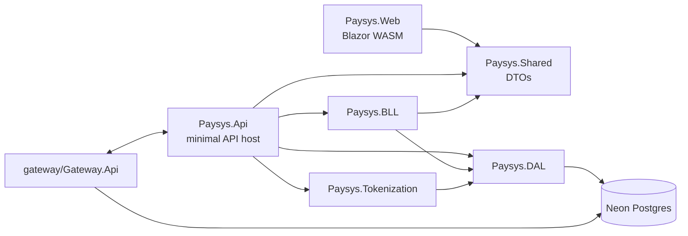

# Paysys: As-Is Architecture (code baseline)

**Version:** 2 (replaces version 1 of 9 Oct 2026, commit `5ba015f`). **Status:** Draft. **Owner:** Ismail Aslan. **ADM phases:** B, C, D (baseline only).
**Evidence:** repository `ismailaslan/paysys`, branch `main`, commit `0311c9c` (23 Nov 2026). Statements were read from the code. Since version 1 the code is built and its tests run on every push in the `ci` workflow (148 test methods; database tests run against a throwaway Postgres 16). The deployed demo (API on Render, web on GitHub Pages) was exercised by the owner. The gateway (section 4.6) was run end to end by the owner on 23 Nov 2026 against the deployed bank: a terminal request through the gateway returned a payment code, the payer paid with it and the PIN, and the merchant's page showed the payment. This is a manual run, not an automated test.

---

## 1. Scope

Paysys is a payment processing system built as a portfolio and demonstration project: banks, merchants and individuals, card tokenization, a PIN-confirmed payment flow, transaction settlement with currency conversion and cross-bank routing, a tamper-evident audit trail, and a payment gateway in front of terminals. It describes what exists; targets and gaps belong in the Roadmap (tab 6).

## 2. System context

| Actor / system | Interaction |
|---|---|
| Individual (role `user`) | Signs up and in at the Individual door, manages own cards (pause, resume, delete), sets a PIN, pays with a card plus the PIN |
| Merchant (role `merchant`) | Signs up and in at the Merchant door, gets a till account with a terminal id, can add terminals (up to 5), issues payment codes, creates a gateway key per terminal |
| Bank (role `bank`) | Created by the admin (no public sign-up); sees its customers, cards and payments; can block and unblock cards held at that bank |
| Platform admin (role `admin`) | Creates banks and bank logins, reads any account, reads audit status |
| Blazor WASM client (`Paysys.Web`) | Browser front end on GitHub Pages; calls the API with a JWT |
| Neon Postgres | One database for Paysys and, in its own `gateway` schema, for the gateway |
| Payment gateway (`gateway/`) | Separate service between terminals and a bank (section 4.6) |
| Destination bank (external) | Called over HTTPS for approval when source and destination accounts are at different banks |

There is no external identity provider, payment network or exchange-rate feed.

## 3. Solution structure

Source projects: Paysys.Web, Paysys.Api, Paysys.BLL, Paysys.Tokenization, Paysys.DAL, Paysys.Shared, plus `gateway/Gateway.Api`. Test projects: Api, BLL, DAL, Tokenization, TestSupport (throwaway Postgres helpers) and `gateway/Gateway.Tests`. The gateway shares no code with Paysys: it talks to a bank only through HTTP.

Runtime: .NET 10, EF Core 10 with Npgsql, ASP.NET Core minimal APIs, JWT bearer authentication, SignalR (gateway to browser).

## 4. Components

### 4.1 Paysys.Api (host)
- Endpoint files: Auth, Accounts, Banks, Payees, Payments (PIN, two-step payment, demo shop), Cards (status, merchant terminals), Gateway (bank side), Tokenization, Transactions, ExchangeRates, Audit, Platform, BankStub, Health.
- Pipeline: exception handler (JSON with trace id) → HTTPS redirection → CORS (origins from configuration) → authentication → request-outcome logging → authorization.
- Background services: audit-chain verification (30 seconds after start, then every 15 minutes) and the gateway notifier (a queue that sends signed completion messages with three retries).
- Sign-in has one door per kind (Individual, Merchant, Bank), enforced by role on the server.

### 4.2 Paysys.BLL (business logic)
| Service | Responsibility |
|---|---|
| `TransactionProcessingService` | The transfer flow (section 6.1) |
| `TransactionAuditLogService` | Appends to and verifies the hash chain; records denials and rejected attempts |
| `CardToAccountResolver`, `CardIssuer`, `CardTokenFingerprint` | Card token to account; card issuing for the demo; safe reference for a presented token |
| `CrossBankRoutingClient`, `BankEndpointPolicy` | Cross-bank approval call and its SSRF controls |
| `PayeeService`, `PayeeCodes`, `PaymentCodeService`, `PaymentCodeStore`, `PayeeGrantStore` | Account numbers; six-digit one-use two-minute payment codes, optionally carrying an amount that binds the payer who looked it up |
| `PendingPaymentStore`, `PinThrottle` | A created payment parked for five minutes until the PIN confirms it; five wrong PINs lock PIN checks for five minutes (restored from the audit log after a restart) |
| `AccessDenialRateLimiter`, `DemoFundsThrottle` | Per-user denial budget; at most 10 demo top-ups per hour per user |
| `FixedExchangeRateProvider` | Fixed in-code rates for 16 currencies, through USD |

### 4.3 Paysys.Tokenization
Validates the card number (13-19 digits, Luhn) and expiry, then stores only an opaque token, the last four digits, brand and expiry. The card number is neither stored nor hashed. A card has a status: Active, Paused (owner can resume), Blocked (only the bank can unblock), Closed (deleted by the owner, never reused). Only an Active card can pay.

### 4.4 Paysys.DAL
`PaysysDbContext`, 12 entity files (Account, Bank, CardToken, CardStatus, Transaction, FraudCheckLedger, TransactionAuditLog, User, enums), 19 EF migrations, unique-violation helper. Connection string `ConnectionStrings:Paysys` is required. Migrations are applied by hand (`dotnet ef database update`), not at start-up.

### 4.5 Paysys.Web
Blazor WASM pages: Login, Signup, Home (Send money with PIN steps), Accounts, Cards, Collect (merchant: payment codes, terminals, gateway key, live payments), Bank, Banks, Platform, Audit, History, Flow. The Collect page listens to the gateway live and falls back to refreshing every 3 seconds when the gateway is not set up.

### 4.6 Payment gateway (`gateway/Gateway.Api`)
A separate .NET service with its own Dockerfile and its own `gateway` schema in the same Neon database, created by the service on start. A terminal asks it for a payment (`POST /v1/payments`, authenticated by terminal id and key); the gateway asks the bank for a payment code carrying the amount; when the payer pays, the bank sends a completion message signed with HMAC-SHA256 (timestamp window, one event id handled once); the gateway matches it to the request and pushes it through a SignalR hub to the merchant's browser, which connects with a one-use 60-second ticket minted by the bank after its own ownership check. Banks are configured, not registered by users. State in memory: tickets, hub connections, and the bank's message queue.

## 5. Data architecture

| Entity | Notes |
|---|---|
| `User` | Username, role (`admin`, `user`, `merchant`, `bank`; a check constraint enforces the set), password hash, optional PIN hash. Sign-in reads this table |
| `Account` | Balance `numeric(18,2)`, currency, `AccountType`, `ClientType`, `BankId`, optional `TerminalId`, `OwnerId`, optional unique `PayeeCode`; `xmin` is the concurrency token |
| `Bank` | Name, unique code, optional `ApiEndpoint` |
| `CardToken` | One account; unique token; last four, brand, expiry, status |
| `Transaction` | Amount, converted amount and currency, rate, status, unique `IdempotencyKey`, optional card |
| `FraudCheckLedger` | One row per attempt, read by the fraud heuristics |
| `TransactionAuditLog` | Append-only hash chain (section 6.2) |
| Gateway: `Terminals`, `Payments`, `ProcessedEvents` | Terminal key hashes, payment requests and their status, handled event ids |

## 6. Key flows

### 6.1 Payment
1. A payer with a PIN creates a payment (`POST /api/payments`): validated and parked, nothing moves. Without a PIN, the payer sets one first (a user with a PIN cannot use the one-step endpoint).
2. The payer confirms with the PIN (`POST /api/payments/{id}/confirm`). Three wrong PINs cancel the pending payment; five lock PIN checks.
3. `TransactionProcessingService.ProcessAsync`: amount rules; idempotency replay; resolve the card to account and bank; the card must be owned by the caller and Active; destination must exist; a Business account cannot be a source; cross-bank approval when banks differ; if a payment code carried an amount, the converted amount must equal it; exchange rate and conversion; fraud heuristics (flag only); the payer is debited under the version check; the destination is credited with one atomic `balance = balance + amount` inside the same database transaction as the audit append, so many payments to one merchant do not conflict; a `TransactionCreated` audit entry is appended in that transaction.
4. After the commit, a completed payment into a terminal's account is queued to the gateway.

### 6.2 Audit append and verification
- Append takes Postgres advisory lock `0x5041595359535F41`, reads the tail, builds the entry (`PreviousEntryId`, `PreviousHash`, SHA-256 `Hash`, actor when present), saves and commits; money movement on the same context rides in that transaction. An optional step runs inside the transaction after the lock (used for the atomic credit).
- Verify loads all entries and walks from the genesis entry; failures are logged at Critical and reported to admins.
- Tail deletion: each clean run keeps the newest entry it saw (id, hash, count) as an anchor in memory, and the next run fails if that entry is gone or changed, so removing or replacing the newest entries between runs is reported. After an instance restart the first run has no anchor. The newest entry's id and hash are in the admin status, so they can be recorded outside the database. Deleting a middle entry is refused by the database (foreign key on `PreviousEntryId`). Verification loads the full table.

## 7. Security architecture (as implemented)

| Control | Implementation |
|---|---|
| Authentication | JWT bearer HS256, 30-minute lifetime; startup fails if the key is missing or short |
| Authorization | Roles admin, user, merchant, bank; ownership checks in services and endpoints; bank actions limited to cards at the bank's own accounts |
| Sign-in | One door per kind, role-checked on the server; per-username lockout with growing backoff |
| Sign-up | Public for Individual and Merchant only; 2000 users in total; 5 sign-ups per client address, refilling one per 12 minutes |
| Payment PIN | Four digits, hashed with ASP.NET Identity's hasher; throttled; set and changed with audit entries (never the PIN) |
| Demo limits | 5 cards per account, 5 terminals per merchant, 10 top-ups an hour per user, balance cap 10,000 |
| Denial rate limit | Per user token bucket, burst 10, refill 1 per second |
| Card data | Isolated in `Paysys.Tokenization`; no number or number hash stored |
| SSRF on bank calls | `BankEndpointPolicy`, connect-time address check, no redirects or proxy, 5 s timeout, 64 KB response cap |
| Gateway trust | Terminal keys stored as hashes; bank keys compared in constant time; completion messages signed with a timestamp window; stream tickets one-use for 60 seconds |
| Secrets | Environment variables on Render; gitleaks on every push |
| Error handling | Generic message plus trace id |

Endpoints without a user token: sign-in, sign-up, currency and exchange-rate reads, health, the bank-approval stub (by design), and the gateway's payment-code endpoint (authenticated by a shared key instead). The bank list and the total transaction count now require authentication (the count: admin only).

## 8. Technology and runtime

| Concern | As built |
|---|---|
| Hosting | API: Docker on Render (auto-deploys from `main`); web: GitHub Pages; gateway: its own Dockerfile, to be deployed as a second Render service |
| Database | Neon Postgres, migrations by hand |
| State in process memory | Login, PIN and demo-funds throttles, denial limiter, pending payments, payment codes and amount bindings, audit status, the gateway queue; gateway tickets and hub connections. Correct only as one instance of each service |
| CI | `ci` (build and test against Postgres 16, load test excluded), `gitleaks`, `pages`, `load` (manual), `uptime` (does nothing until the repository variable `LIVE_URL` is set) |
| Tests | 148 test methods across Api, BLL, DAL, Tokenization and gateway projects |
| API documentation | Raw OpenAPI document in Development only; the gateway contract is described in `gateway/README.md` |

## 9. Position against the seven benchmark criteria

| Criterion | What the code and runs show |
|---|---|
| 1 Tokenization security | Isolated project; format, Luhn, expiry checks; no card number or hash stored; PIN-confirmed payments with lockout; card pause, bank block and delete. Tested in CI since 23 Nov 2026 (7 tests): a known test card number and a demo-issued one are searched for in every column of every table, and in every log line at every level, and are never found (the searches are shown to work: they find the token and the rejection log line); rejected-card responses never repeat the number; no column could hold a number or CVV; only 5 source files may name the card number, only the Api references the tokenization project, and the tokenization project references neither the BLL nor the Api. Not covered: memory dumps, the browser (the demo-issue endpoint returns the generated number once, by design), transport (TLS is Render's and GitHub's). No formal review |
| 2 Settlement speed | Load test (8 parallel payers, 25 transfers each, throwaway Postgres on a shared CI runner, 23 Nov 2026): 187.6 completed/s with payers paying separate merchants (p50 24 ms, p95 62 ms); 306.1 completed/s with all payers paying one merchant, 200 of 200 completed, no conflicts. A floor, not server capacity. Every audit append still takes a global lock, so that is the ceiling |
| 3 Auditability | Hash chain with actor on every entry, denials, rejections, card changes and PIN events recorded; scheduled verification. Tested in CI (10 tests, real Postgres): an edited entry, a broken link, removal of the newest entry (with the anchor), removal of all entries, replacement of the newest entry with a forged one are all detected; a chain that only grew stays valid; deleting a middle entry is refused by the database. Limits: the anchor is in memory, so it covers the time between runs of a running instance, not a restart; someone with full database access who also holds the process can still rewrite everything, which only an external copy of the head hash would stop |
| 4 Compliance | Logging discipline, lockout, SSRF controls, demo limits. No certification or assessment |
| 5 Fraud detection | Two flag-only heuristics: RapidRepeat (another attempt from the same account within 10 seconds, failed attempts included) and HighValueRepeat (two payments of 10,000 or more within a minute). Tested in CI (12 tests, real Postgres): a first payment is not flagged; a quick second one is flagged and still completes with both balances moved; a burst flags every payment after the first; windows (30 s outside, 5 s inside); other accounts' activity does not count; a failed attempt counts as history; every attempt writes exactly one ledger row. What this shows is that the rules do what they say, not that they catch real fraud: there is no real traffic to measure against, a legitimate retry within 10 seconds is flagged, and a flag is only recorded (audit entry and payment-steps view), nobody is alerted |
| 6 Uptime / reliability | Correctness under concurrency evidenced (money conserved, chain valid, in the load test and a concurrency test). Single instance, in-memory state; the uptime check is not active until `LIVE_URL` is set. No failover |
| 7 Integration cost | Gateway contract documented in `gateway/README.md` and DR-005; no general API integration guide |

## 10. Drift from the Notion "5 Definition" page

Items 1-10 of version 1 still stand except where this version replaces them: users now live in the `Users` table (not configuration); the `docs/architecture` folder exists; a Dockerfile and CI exist. Open drift:

| # | Notion page says | Code says |
|---|---|---|
| 1 | Entities `ExchangeRate`, `FraudFlag`, `Card`, `AuditEntry` | Rates are hardcoded in `FixedExchangeRateProvider`; the flag lives in the audit entry; entities are `CardToken` and `TransactionAuditLog` |
| 2 | DR-003: Redis for idempotency, balance locking, rate limiting (undecided) | None use Redis. Idempotency is a unique index, concurrency is `xmin` plus an atomic credit, rate limiting is in memory. Not needed for a single instance |
| 3 | Not mentioned | Roles merchant and bank, card status, terminals, PIN flow, gateway, demo limits, amount on payment codes |

## 11. Known limitations that follow from the code

- Single instance of each service (in-memory state); Render's free tier sleeps after idle time.
- Global serialization of every audit write.
- Audit anchor is in memory: tail deletion is caught between runs of one running instance, not across a restart; verification loads the full table.
- Fixed exchange rates; no rate history.
- A 4-digit PIN has a small search space; the lockout limits online guessing, not offline attack on a stolen hash.
- Pending payments and payment codes are lost on a restart.
- Unauthenticated endpoints that remain: currency list, exchange rate, health, and the bank-approval stub (by design).
- The gateway's end-to-end run was manual (23 Nov 2026), not an automated test; no card-present charging through the gateway.
