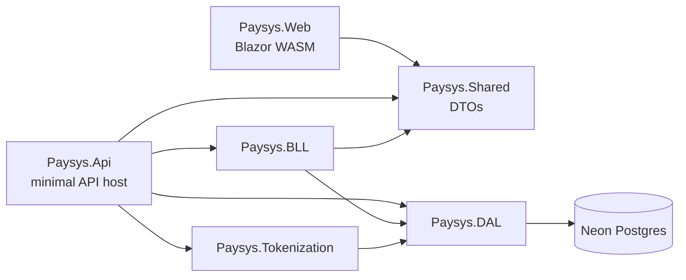

# Paysys: As-Is Architecture (code baseline)

**Status:** Draft. **Owner:** Ismail Aslan. **ADM phases:** B, C, D (baseline only).
**Evidence:** repository `ismailaslan/paysys`, branch `main`, commit `5ba015f` (9 Oct 2026). Every statement below was read from the code at that commit. Where this document and the Notion "5 Definition" page disagree, the code wins and the difference is listed in section 10.
**Not verified by running:** the system was not built or run to write this document. Behaviour is read from source.

---

## 1. Scope

Paysys is a payment processing system built as a portfolio and demonstration project: accounts, card tokenization, transaction settlement with currency conversion and cross-bank routing, and a tamper-evident audit trail. This document describes what exists, not what is planned. Targets and gaps belong in the Roadmap (tab 6).

## 2. System context

| Actor / system | Interaction |
|---|---|
| End user (role `user`) | Signs in, manages own cards, makes transfers, reads own transaction history |
| Admin (role `admin`) | Everything a user can do, plus: create accounts, create banks, read any account's transactions, read audit-chain status |
| Blazor WASM client (`Paysys.Web`) | Browser front end; calls the API over HTTP with a JWT |
| Neon Postgres | Single database; all state lives here |
| Destination bank (external) | Called over HTTPS for approval when source and destination accounts are at different banks. In development, a stub inside the API itself (`/api/stub/bank-approval`) answers |

There is no external identity provider, payment network, or exchange-rate feed.

## 3. Solution structure

Actual project references (from the `.csproj` files):

| Project | References |
|---|---|
| Paysys.Web | Shared |
| Paysys.Api | BLL, Tokenization, DAL, Shared |
| Paysys.BLL | DAL, Shared |
| Paysys.Tokenization | DAL |
| Paysys.DAL | none |
| Paysys.Shared | none |

Runtime: .NET 10, EF Core 10 with Npgsql, ASP.NET Core minimal APIs, JWT bearer authentication. Solution file `Paysys.slnx` lists six source projects and four test projects.

## 4. Components

### 4.1 Paysys.Api (host)
- Endpoint files per area: Auth, Accounts, Banks, Payees, Tokenization, Transactions, ExchangeRates, Audit, BankStub. Endpoints validate the request shape, call a service or the `DbContext`, and map exceptions to HTTP results.
- Pipeline order: exception handler (JSON body with trace id) → HTTPS redirection → CORS (`http://localhost:5273`, `https://localhost:7075`) → authentication → request-outcome logging (one log line per response with status ≥ 400) → authorization.
- Background service `AuditChainVerificationService` verifies the audit chain 30 seconds after start and then every 15 minutes (configurable); the latest result is held in `AuditChainStatus`.
- OpenAPI: `AddOpenApi()` is registered, `MapOpenApi()` only in Development. No UI viewer. A bearer-scheme transformer has been added in the working tree (not part of commit `5ba015f`; unbuilt).

### 4.2 Paysys.BLL (business logic)
| Service | Responsibility |
|---|---|
| `TransactionProcessingService` | The transfer flow (section 6.1) |
| `TransactionAuditLogService` | Appends to and verifies the hash chain; records access denials and rejected attempts |
| `CardToAccountResolver` | Resolves a card token to its token row, account and bank |
| `CrossBankRoutingClient` | HTTP call to the destination bank for approval |
| `BankEndpointPolicy` | Validates bank endpoint URLs (SSRF controls, section 7) |
| `PayeeService` / `PayeeCodes` | Opt-in short code that lets one user find another's account without seeing its details |
| `AccessDenialRateLimiter` | Per-user token bucket on denials and rejected attempts |
| `FixedExchangeRateProvider` | Fixed in-code rates for 16 currencies, converted by triangulating through USD, behind `IExchangeRateProvider` |
| `CardTokenFingerprint` | Safe, non-reversible reference for a presented token, stored in audit entries |

### 4.3 Paysys.Tokenization
`CardTokenizationService.TokenizeAsync` checks that the caller owns the account, then validates the card number (13-19 digits, Luhn checksum) and expiry. It stores only an opaque token (`tok_` plus 32 random hex characters), the last four digits, the brand (Visa, Mastercard, Amex, Unknown) and expiry. The card number is neither stored nor hashed.

### 4.4 Paysys.DAL
`PaysysDbContext`, ten entity files, 15 EF migrations (12 Sep to 20 Sep 2026), unique-violation helper, design-time factory. Connection string `ConnectionStrings:Paysys` is required at startup.

### 4.5 Paysys.Web
Blazor WASM pages: Login, Home (payments and payee lookup), Accounts (including payee-code management), Banks, Cards, History. A single `HttpClient` wrapped by `AuthTokenHandler`; sign-in state in `AuthState`. The API base address comes from configuration.

## 5. Data architecture

| Entity | Notes |
|---|---|
| `Account` | Name, balance `numeric(18,2)`, currency, `AccountType` (Person, Bank), `ClientType` (Individual, Business), `BankId`, optional `TerminalId`, `OwnerId` (JWT `sub`), optional unique `PayeeCode`. Postgres `xmin` is the optimistic-concurrency token |
| `Bank` | Name, unique `BankCode`, optional `ApiEndpoint` |
| `CardToken` | Belongs to one account; unique token; last four, brand, expiry |
| `Transaction` | Amount, currency, converted amount/currency, exchange rate (`numeric(18,6)`), status (Pending, Completed, Failed), unique `IdempotencyKey`, optional failure reason, optional card token |
| `FraudCheckLedger` | One row per transaction attempt (account, amount, time); read by the fraud heuristics |
| `TransactionAuditLog` | Append-only hash chain (section 6.2). Not a foreign-keyed user table: `ActorUserId` is a plain GUID because users live in configuration |

Users are not stored in the database: they come from `Auth:Users` configuration, with the password hash supplied by user-secrets (in Development a fallback hash of a fixed dev password is generated if none is set).

## 6. Key flows

### 6.1 Transfer (`POST /api/transactions`)
1. Reject amounts that are ≤ 0, above 1,000,000,000,000, or with more than two decimals.
2. If the idempotency key already exists, replay the stored result (ownership is re-checked on replay).
3. Resolve the source card token to account and bank. Unknown token: record a *rejected attempt* audit entry (fingerprint only) and return 404.
4. Source account must be owned by the caller. Otherwise: record an *access denied* audit entry and return 403.
5. Destination account must exist. A Business account cannot be a source.
6. If source and destination banks differ, call the destination bank for approval (section 7). Success and failure are both written to the audit chain immediately.
7. Compute the exchange rate (1 when currencies match) and the converted amount, rounded to two decimals, ToEven.
8. Create the transaction. Insufficient funds, or a bank decline, marks it Failed. Otherwise fraud heuristics run, balances move, and it is marked Completed.
9. A `FraudCheckLedger` row is added for every attempt.
10. A `TransactionCreated` audit entry is appended and everything is saved in one database transaction under the chain lock.
11. If the idempotency unique index is hit by a concurrent request, state is cleared and the winner's transaction is returned. A concurrency conflict on an account returns 409.

Fraud heuristics flag but never block: `RapidRepeat` (another attempt from the same account within 10 seconds) and `HighValueRepeat` (an amount ≥ 10,000 with another such attempt from the same account within one minute). Flags are stored comma-separated as `FlagReason` on the audit entry.

Not implemented: PIN validation is marked as a hook point in `TransactionProcessingService` and in `Home.razor`.

### 6.2 Audit append and verification
- **Append** (`AppendAndSaveAsync`): opens a database transaction, takes Postgres advisory lock `0x5041595359535F41`, reads the current tail (the entry no other entry points to), builds the entry with `PreviousEntryId`, `PreviousHash` and its own SHA-256 `Hash`, saves, commits. Any money movement pending on the same `DbContext` is saved in that same transaction. Chain order is defined by the explicit `PreviousEntryId` pointer, which has a unique index.
- **Hash input:** entry fields joined with `|`, plus `|actor=<id>` only when `ActorUserId` is present, so entries written before that column existed still verify. Timestamps are truncated to microseconds so the hash survives a database round-trip.
- **Actor:** every audit write path in `TransactionProcessingService` and the denial/rejection recorders passes the authenticated user's id.
- **Verify** (`VerifyChainIntegrityAsync`): loads all entries, requires exactly one genesis entry, walks from genesis checking each `PreviousHash` linkage and recomputed `Hash`, and checks that every entry was visited. A failure is logged at Critical and reported at `GET /api/audit/integrity` (admin only).
- **Known blind spot (stated in the code):** deleting the newest entries is not detected, because nothing outside the table records the latest hash. All entries are loaded into memory on each run.

## 7. Security architecture (as implemented)

| Control | Implementation |
|---|---|
| Authentication | JWT bearer, HS256, issuer `paysys-api`, audience `paysys-web`, 30-minute lifetime, 30-second clock skew; startup fails if the signing key is missing or under 32 characters |
| Authorization | Roles `admin` and `user`; policy `Admin`; per-account ownership checks in services and endpoints |
| Login throttle | Per username: lock after 5 failures, 30 s base lock growing to a 15 min cap; tracks at most 10,000 usernames; in memory |
| Denial rate limit | Per user token bucket, burst 10, refill 1 per second, shared by access denials and rejected attempts; over budget returns 429 before anything is written |
| Card data | Isolated in `Paysys.Tokenization`; no card number or card-number hash stored; audit entries hold a fingerprint of a presented token |
| SSRF on bank calls | `BankEndpointPolicy`: HTTPS required (HTTP only for the allowlisted development stub), localhost and private addresses rejected, DNS result re-checked at connect time through a `ConnectCallback`; the HTTP client disables redirects and proxies, with a 5 s timeout and 64 KB response cap |
| Secrets | user-secrets or environment variables; gitleaks scan on every push and pull request (`.github/workflows/gitleaks.yml`) |
| Error handling | Global handler returns a generic message plus trace id, no stack trace |

Endpoints that do **not** require authentication: `POST /api/auth/login`, `GET /api/banks`, `GET /api/currencies`, `GET /api/exchange-rate`, `GET /api/transactions/count`, `POST /api/stub/bank-approval`. Everything else requires a token; creating accounts, creating banks and reading audit status require the admin role.

## 8. Technology and runtime

| Concern | As built |
|---|---|
| Hosting | No deployment artefacts in the repository (no Dockerfile, no infrastructure code). Local run via `dotnet run` with launch profiles; API on `http://localhost:5121`, web on `http://localhost:5273` |
| Database | Neon Postgres, EF Core migrations applied with `dotnet ef database update` |
| State held in process memory | Login throttle, denial rate limiter, audit verification status. The system is correct only as a single API instance |
| CI | One workflow: gitleaks. No build, test or deploy pipeline |
| Tests | Four test projects are listed in the solution. Api, BLL and DAL each hold one `UnitTest1.cs`; `Paysys.Tokenization.Tests` has a project file and no test file. No real coverage |
| API documentation | None beyond the Development-only raw OpenAPI document |

## 9. Position against the seven benchmark criteria

| Criterion | What the code shows |
|---|---|
| 1 Tokenization security | Isolated project; format, Luhn and expiry checks; no card number or hash stored. No PIN validation. No formal review |
| 2 Settlement speed | Not worked on. Every audit append takes a global advisory lock and writes one row, so transaction throughput is serialized by the chain |
| 3 Auditability | Hash chain with actor on every entry, denials and rejections recorded, scheduled verification. Tail deletion undetected |
| 4 Compliance | Logging discipline, lockout, SSRF controls. No certification or compliance assessment |
| 5 Fraud detection | Two flag-only heuristics |
| 6 Uptime / reliability | Not worked on; in-memory state restricts it to one instance |
| 7 Integration cost | No API documentation or integration guide |

## 10. Drift between this baseline and the Notion "5 Definition" page (8 Oct 2026)

| # | Notion page says | Code says |
|---|---|---|
| 1 | `Paysys.Tokenization` may depend on nothing | It references `Paysys.DAL` |
| 2 | `Paysys.BLL` may depend on DAL, Shared, Tokenization | BLL references DAL and Shared only; the API references Tokenization directly |
| 3 | `Paysys.DAL` may depend on Shared | DAL has no project references |
| 4 | Data entity `ExchangeRate` (rates against USD, 16 currencies) | No such entity or table. The USD pivot and 16 currency codes do exist, hardcoded in `FixedExchangeRateProvider` |
| 5 | Entity `FraudFlag` | `FraudCheckLedger` records attempts; the flag lives in `FlagReason` on the audit entry |
| 6 | Entity `Card` | Entity is `CardToken` |
| 7 | Entity `AuditEntry` | Entity is `TransactionAuditLog`, with a nullable `ActorUserId` |
| 8 | Not mentioned | Account ownership (`OwnerId`), payee codes, login throttle, denial rate limiter, SSRF policy, scheduled chain verification, request-outcome logging |
| 9 | Decision DR-003: Redis for idempotency keys, balance locking and rate limiting (undecided) | None of these use Redis; idempotency is a unique index, concurrency is `xmin`, rate limiting is in memory |
| 10 | Architecture documents live in `docs/architecture` in the repository | The folder did not exist at commit `5ba015f`; this file creates it |

## 11. Known limitations that follow from the code

- Single instance only (in-memory throttles and status).
- Global serialization of every audit write.
- Audit tail deletion is undetectable; verification loads the full table.
- Fixed exchange rates; no rate history.
- PIN checks not implemented on either side.
- Unauthenticated read endpoints: bank list, currency list, exchange rate, and the total transaction count.
- No test coverage, API docs, build pipeline or deployment definition.
